  

  
  
  
  

### hey, I'm RetryX 👋

Engineer from a different field, dev enthusiast for a long time.

These days I build small dev tools and send pull requests to open-source projects I actually use. I try something, write down what broke, then run it again a bit better. This profile is the save file.

### 🌍 open source

  

<!-- OSS:START -->
| | project | pull request | status | diff |
|:-:|---|---|:-:|--:|
|  | [GoogleChrome/modern-web-guidance-src](https://github.com/GoogleChrome/modern-web-guidance-src) ★ 8.4K | [validation: require macro-referenced features in web-feature-ids](https://github.com/GoogleChrome/modern-web-guidance-src/pull/3592) #3592 |  | `+120 −21` |
|  |  | [analyzing: ignore &lt;script&gt;/&lt;style&gt; blocks inside HTML comments](https://github.com/GoogleChrome/modern-web-guidance-src/pull/3588) #3588 |  | `+73 −8` |
|  |  | [analyzing: judge explicit file targets by the file itself](https://github.com/GoogleChrome/modern-web-guidance-src/pull/3590) #3590 |  | `+60 −7` |
|  |  | [analyzing: apply element rules to JSX in .js/.mjs/.cjs files](https://github.com/GoogleChrome/modern-web-guidance-src/pull/3589) #3589 |  | `+160 −12` |
|  |  | [cli(retrieve): suggest similar guide IDs and accept path-like IDs](https://github.com/GoogleChrome/modern-web-guidance-src/pull/3591) #3591 |  | `+384 −15` |
<!-- OSS:END -->

Refreshed daily from the GitHub API by <a href="scripts/update_oss.py">a small script</a>. Only PRs to other people's repos count; PRs closed without merging are not listed.

### 🛠️ my projects

<table>
  <tr>
    <td width="50%">
      
    </td>
    <td width="50%">
      <h3><a href="https://github.com/on-retryx/exam-forge">Exam Forge</a></h3>
      Turns lecture-note PDFs into a printable question book. Every question is tied to a page and a quote from the source, and a separate review step has to pass it before it gets into the book.
        
      Started as a tool to help someone close to me study for exams. It worked, so I cleaned it up and open-sourced it, with a small pixel-art studio that shows the pipeline live.
        
      <code>Python</code> <code>Claude Code plugin</code> <code>MIT</code>
    </td>
  </tr>
</table>

### 📒 retry log

| attempt | what | result |
|:-:|---|---|
| #1 | [Exam Forge](https://github.com/on-retryx/exam-forge), my first open-source tool | ✅ shipped |
| #2 | first PRs merged into [GoogleChrome/modern-web-guidance-src](https://github.com/GoogleChrome/modern-web-guidance-src) | ✅ merged |
| #3 | a dev team tool that logs, reviews and releases itself | 🔄 looping |
| #n | whatever breaks next | ⏳ |

### 🧰 toolbox

  
  
  
  
  
  
  
  

### 📡 find me

I post the experiments, wins and fails on X, in Turkish 🇹🇷 → [@Rretryx](https://x.com/Rretryx)

last run failed successfully. retrying… 🔁

