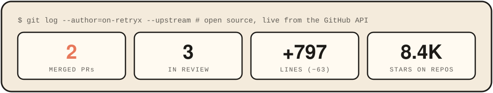

  <picture>
    <source media="(prefers-color-scheme: light)" srcset="assets/header-light.svg">
    
  </picture>

  
  
  
  

### `>_` hey, I'm RetryX

Engineer from a different field, dev enthusiast for a long time.

These days I build small dev tools and send pull requests to open-source projects I actually use. I try something, write down what broke, then run it again a bit better. This profile is the save file.

### `↻` open source

  <picture>
    <source media="(prefers-color-scheme: light)" srcset="assets/oss-stats-light.svg">
    
  </picture>

<!-- OSS:START -->
| | project | pull request | status | diff |
|:-:|---|---|:-:|--:|
|  | [avenoxai/avenoxbeyin](https://github.com/avenoxai/avenoxbeyin) ★ 564 | [feat(devices): detect and plan a phone layout (solo/phone), first step of #205](https://github.com/avenoxai/avenoxbeyin/pull/848) #848 |  | `+741 −3` |
|  | [GoogleChrome/modern-web-guidance-src](https://github.com/GoogleChrome/modern-web-guidance-src) ★ 10.3K | [validation: require macro-referenced features in web-feature-ids](https://github.com/GoogleChrome/modern-web-guidance-src/pull/3592) #3592 |  | `+120 −21` |
|  |  | [analyzing: ignore &lt;script&gt;/&lt;style&gt; blocks inside HTML comments](https://github.com/GoogleChrome/modern-web-guidance-src/pull/3588) #3588 |  | `+73 −8` |
<!-- OSS:END -->

Refreshed daily from the GitHub API by <a href="scripts/update_oss.py">a small script</a>. Only PRs to other people's repos count; PRs closed without merging are not listed.

### `✓` my projects

<table>
  <tr>
    <td width="50%">
      
    </td>
    <td width="50%">
      <h3><a href="https://github.com/on-retryx/exam-forge">Exam Forge</a></h3>
      Turns lecture-note PDFs into a printable question book. Every question is tied to a page and a quote from the source, and a separate review step has to pass it before it gets into the book.
        
      Started as a tool to help someone close to me study for exams. It worked, so I cleaned it up and open-sourced it, with a small pixel-art studio that shows the pipeline live.
        
      <code>Python</code> <code>Claude Code plugin</code> <code>MIT</code>
    </td>
  </tr>
</table>

### `#n` retry log

| attempt | what | result |
|:-:|---|:-:|
| #1 | [Exam Forge](https://github.com/on-retryx/exam-forge), my first open-source tool |  |
| #2 | first PRs merged into [GoogleChrome/modern-web-guidance-src](https://github.com/GoogleChrome/modern-web-guidance-src) |  |
| #3 | a dev team tool that logs, reviews and releases itself |  |
| #n | whatever breaks next | … |

### `$` toolbox

  
  
  
  
  
  
  
  
  

### `@` find me

I post the experiments, wins and fails on X, in Turkish 🇹🇷 → [@Rretryx](https://x.com/Rretryx)

✗ last run failed successfully &nbsp;·&nbsp; ↻ retrying…

